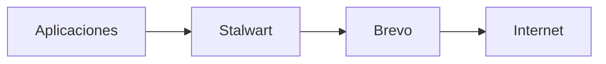

# AGENTS.md — MDXLAB Homelab

## Propósito

Este repositorio contiene las definiciones, documentación y configuración versionable del homelab **MDXLAB** (`mdxlab.dev`).

Este archivo define las reglas que deben seguir los agentes al analizar o modificar el repositorio.

## 1. Principios generales

- No asumir que un servicio está desplegado únicamente porque existe un `docker-compose.yaml` en el repositorio.
- Antes de afirmar cómo está configurado un servicio, revisar su Compose y la documentación vigente.
- Diferenciar entre configuración definida en el repositorio, configuración documentada como activa y mejoras todavía pendientes.
- No inventar puertos, rutas, variables, dominios, versiones ni estados no confirmados.
- Si existe una discrepancia entre documentación y Compose, señalarla antes de modificarla.
- Preferir cambios pequeños, explícitos y fáciles de revisar.
- No intentar pruebas, validaciones operativas ni ejecutar comandos contra servicios desde el PC personal: los servicios se ejecutan directamente en los servidores. Limitarse al análisis de la configuración y documentación versionadas, salvo instrucción explícita del usuario.

## 2. Documentación

La documentación principal se encuentra en `docs/`.

### Arquitectura activa

`docs/arquitectura_homelab_mdxlab_activa.md`

Representa el **estado funcional vigente** del homelab.

Debe contener servidores y recursos, servicios activos, almacenamiento, dominios y DNS, puertos relevantes, Nginx Proxy Manager, Cloudflare Tunnel, rutas y persistencia, configuraciones activas importantes, dependencias, arquitectura de correo y notas técnicas permanentes.

No utilizar este documento como bitácora. Cuando una mejora pase a formar parte de la infraestructura real, documentar aquí únicamente su **estado final**.

### Roadmap e histórico

`docs/roadmap_historico_homelab_mdxlab_nuevo.md`

Contiene mejoras pendientes, tareas en progreso, decisiones técnicas relevantes e incidencias que aporten conocimiento reutilizable.

Las entradas históricas deben ser breves y registrar solamente:

1. qué ocurrió;
2. cómo se resolvió de forma general;
3. cuál fue el resultado.

Evitar transcripciones extensas de comandos, logs, pruebas o conversaciones.

## 3. Formato Markdown

Mantener el estilo establecido en la documentación de MDXLAB.

Para información de inventario utilizar **tablas Markdown reales con pipes**:

```markdown
| Servicio | FQDN | Puerto |
|---|---|---:|
| Ejemplo | `ejemplo.mdxlab.dev` | `8080` |
```

No convertir estas tablas a listas, tablas ASCII, tablas Pandoc ni HTML.

Mantener encabezados numerados cuando el documento ya utilice numeración y backticks para archivos, rutas, FQDN y puertos.

Utilizar Mermaid para diagramas de arquitectura, red, rutas y flujos. Preferir `flowchart TB` para arquitecturas jerárquicas y `flowchart LR` para flujos y rutas. Utilizar `subgraph` cuando ayude a representar capas o zonas. Mantener los diagramas simples y legibles; no utilizar diagramas ASCII basados en espacios salvo que exista una razón técnica para no utilizar Mermaid, ni estilos, colores o decoraciones innecesarias.

No reformatear un documento completo cuando solamente se necesita modificar una sección.

## 4. Docker y Compose

Los servicios Docker se organizan principalmente en directorios individuales con su propio `docker-compose.yaml`.

Antes de modificar un servicio:

1. revisar su `docker-compose.yaml`;
2. identificar volúmenes y bind mounts;
3. identificar puertos publicados;
4. identificar redes y dependencias;
5. revisar variables de entorno sin exponer secretos;
6. contrastar el resultado con la arquitectura documentada.

No asumir que todos los directorios representan servicios actualmente activos.

### Comandos para los servidores

Los servidores Debian de MDXLAB requieren privilegios elevados para Docker.

Utilizar:

```bash
sudo docker ...
sudo docker compose ...
```

Ejemplos:

```bash
sudo docker ps
sudo docker logs --tail 100 stalwart
sudo docker compose up -d
sudo docker compose restart
```

No eliminar `sudo` salvo que se confirme explícitamente un cambio en la configuración del servidor.

## 5. Secretos y `.env`

No mostrar, copiar ni incorporar a documentación contraseñas, SMTP keys, API keys, tokens de Cloudflare, `ADMIN_TOKEN`, claves privadas TLS ni otros secretos.

No solicitar que se peguen secretos si puede evitarse.

Los Compose pueden referenciar variables almacenadas en `.env`, pero la documentación debe registrar únicamente el nombre o propósito de la variable, nunca su valor.

No modificar archivos `.env` ni secretos salvo petición explícita.

## 6. Red y exposición

Dominio principal: `mdxlab.dev`.

La arquitectura distingue deliberadamente entre FQDN LAN y FQDN públicos.

> **Cada FQDN debe tener una ruta de resolución clara y predecible.**

Los nombres LAN utilizan Pi-hole y los servicios publicados utilizan Cloudflare según la arquitectura activa.

No publicar un servicio en Internet ni añadirlo a Cloudflare Tunnel sin petición explícita. No asumir que un servicio LAN debe ser público.

## 7. Nodos

| Nodo | IP | Rol principal |
|---|---|---|
| 102 | `192.168.0.102` | Infraestructura, Pi-hole y MariaDB |
| 103 | `192.168.0.103` | Docker, aplicaciones, almacenamiento, proxy, túneles y correo |

Consultar la arquitectura activa antes de asumir hardware, almacenamiento o servicios adicionales.

## 8. Correo

Arquitectura actual de salida:



Stalwart actúa como servidor SMTP central y Brevo como relay SMTP externo.

La recepción pública de `mdxlab.dev` utiliza actualmente Cloudflare Email Routing.

No cambiar MX, SPF, DKIM o DMARC sin revisar primero la configuración vigente y justificar el cambio.

No asumir que un problema de spam implica un fallo de autenticación. Revisar evidencias antes de modificar DNS.

## 9. Cambios en infraestructura

Cuando se complete una mejora:

1. modificar la configuración correspondiente;
2. validar que funciona;
3. actualizar `docs/arquitectura_homelab_mdxlab_activa.md` con el estado final;
4. actualizar el roadmap;
5. añadir una entrada histórica breve solo si aporta conocimiento reutilizable.

No documentar como activo algo que todavía no haya sido validado.

## 10. Incidencias

Durante troubleshooting:

- avanzar de forma incremental;
- evitar cambiar varias variables simultáneamente;
- comprobar resultados antes del siguiente cambio;
- distinguir síntomas de causas confirmadas;
- conservar logs extensos solo durante el diagnóstico;
- documentar después únicamente las conclusiones útiles.

Una incidencia resuelta debe quedar resumida, no convertirse en una bitácora exhaustiva.

## 11. Cambios destructivos

Antes de ejecutar o recomendar operaciones destructivas, explicar claramente su impacto.

Prestar especial atención a:

```bash
sudo docker system prune
sudo docker volume rm
sudo rm -rf
```

y a operaciones sobre bases de datos, volúmenes Docker, `/mnt/hdd/data_services/`, certificados, DNS, almacenamiento y configuraciones persistentes.

No eliminar datos, volúmenes o configuraciones únicamente porque parezcan no utilizados.

## 12. Forma de trabajo

Para tareas sobre el repositorio:

1. inspeccionar primero;
2. comparar Compose contra documentación;
3. identificar discrepancias;
4. proponer cambios;
5. modificar solamente lo necesario.

Cuando se solicite únicamente revisión o auditoría, **no modificar archivos**.

Si existe incertidumbre sobre el estado real de un servicio, indicarlo explícitamente y verificarlo antes de actualizar la arquitectura.

El objetivo es mantener una representación **precisa, compacta y mantenible** de MDXLAB.
