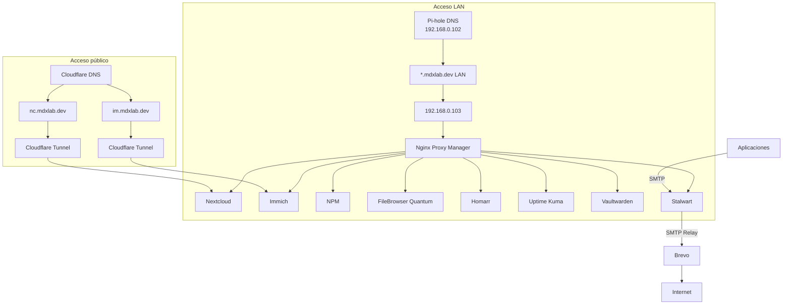
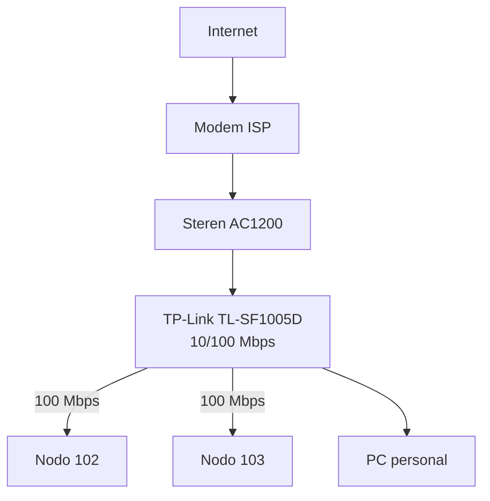
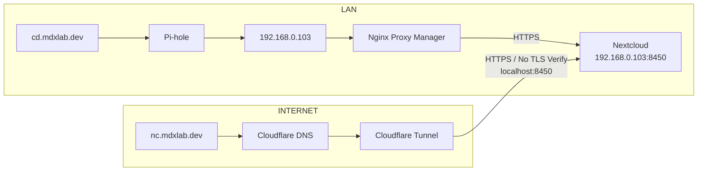
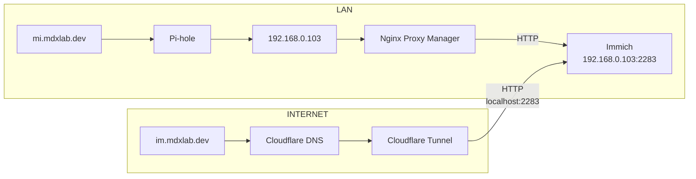
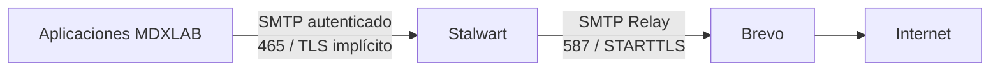
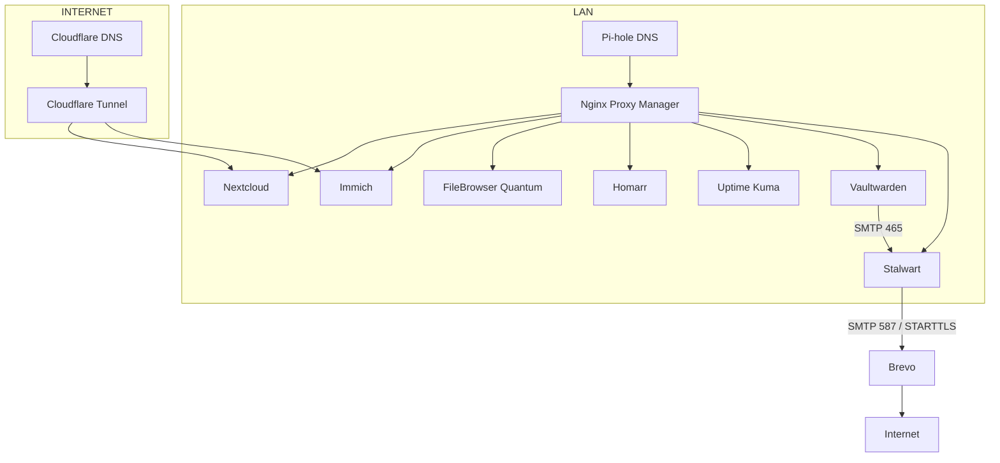

# Arquitectura Homelab --- `mdxlab.dev`

> Estado funcional actual de MDXLAB. Este documento describe únicamente la infraestructura y configuraciones vigentes.

## 1. Resumen de la arquitectura

La infraestructura utiliza rutas separadas para el acceso **LAN** y el acceso **público mediante Cloudflare**. Los servicios internos utilizan Pi-hole y Nginx Proxy Manager; únicamente Nextcloud e Immich están publicados mediante Cloudflare Tunnel.



---

## 2. Servidores

| Recurso | Nodo 102 — Infraestructura | Nodo 103 — Principal |
|---|---|---|
| IP | `192.168.0.102` | `192.168.0.103` |
| SO | Debian 12 Bookworm | Debian 13 Trixie |
| CPU | Intel Pentium D 3.40 GHz | Intel Core i5-10400 |
| Núcleos / hilos | 2C / 2T | 6C / 12T |
| RAM | 2.8 GiB | 32 GB |
| GPU | Intel 82945G/GZ | Intel UHD Graphics 630 / Quick Sync |
| Virtualización | — | Intel VT-x |
| Disco del sistema | HDD Seagate 250 GB | NVMe ADATA ~256 GB |
| Almacenamiento adicional | — | HDD 1 TB NTFS + HDD 6 TB SMR + SSD ~500 GB pendiente |
| Red | Fast Ethernet | NIC Gigabit Realtek RTL8111/8168 (`r8169`) |
| Enlace actual | 100 Mbps | 100 Mbps |
| Docker | No | Sí |
| Rol | Infraestructura / DNS / BD | Aplicaciones / almacenamiento / correo |

### Servicios

| Nodo 102 | Nodo 103 |
|---|---|
| Pi-hole | Nextcloud |
| MariaDB (`3306`) | Immich |
|  | Nginx Proxy Manager |
|  | Cloudflared |
|  | FileBrowser Quantum |
|  | Homarr |
|  | Uptime Kuma |
|  | Vaultwarden |
|  | Stalwart |

> Nextcloud mantiene su base de datos en MariaDB sobre el Nodo 102 (`192.168.0.102:3306`).

### Almacenamiento del Nodo 103

| Unidad | Capacidad | Uso | Estado |
|---|---:|---|---|
| NVMe ADATA | ~256 GB | Debian / Docker | Sistema |
| HDD Seagate | 1 TB | Datos antiguos / reservado | NTFS; ~442 GB de datos antiguos |
| HDD Seagate SMR | 6 TB | Datos del homelab (`/mnt/hdd`) | Almacenamiento principal |
| SSD adicional | ~500 GB | Pendiente de definir | Pendiente de inspección |

### Red física



El `TL-SF1005D` limita actualmente el segmento cableado a **100 Mbps**.

---

## 3. Dominios

### Dominios por servicio

| Servicio | Dominio LAN | Dominio público | Acceso |
|---|---|---|---|
| Nextcloud | `cd.mdxlab.dev` | `nc.mdxlab.dev` | LAN + Internet |
| Immich | `mi.mdxlab.dev` | `im.mdxlab.dev` | LAN + Internet |
| Nginx Proxy Manager | `npm.mdxlab.dev` | — | Solo LAN |
| FileBrowser Quantum | `fl.mdxlab.dev` | — | Solo LAN |
| Homarr | `hr.mdxlab.dev` | — | Solo LAN |
| Uptime Kuma | `uk.mdxlab.dev` | — | Solo LAN |
| Vaultwarden | `vw.mdxlab.dev` | — | Solo LAN |
| Stalwart | `stt.mdxlab.dev` | — | Solo LAN |

Los dominios públicos `nc.mdxlab.dev` e `im.mdxlab.dev` **no tienen override DNS local en Pi-hole**.

---

## 4. Ruta de Nextcloud



---

## 5. Ruta de Immich



---

## 6. Resolución DNS local

| FQDN | Resolución / ruta |
|---|---|
| `cd.mdxlab.dev` | `192.168.0.103` vía Pi-hole |
| `mi.mdxlab.dev` | `192.168.0.103` vía Pi-hole |
| `npm.mdxlab.dev` | `192.168.0.103` vía Pi-hole |
| `fl.mdxlab.dev` | `192.168.0.103` vía Pi-hole |
| `hr.mdxlab.dev` | `192.168.0.103` vía Pi-hole |
| `uk.mdxlab.dev` | `192.168.0.103` vía Pi-hole |
| `vw.mdxlab.dev` | `192.168.0.103` vía Pi-hole |
| `stt.mdxlab.dev` | `192.168.0.103` vía Pi-hole |
| `mail.mdxlab.dev` | `192.168.0.103` vía Pi-hole |
| `nc.mdxlab.dev` | DNS público de Cloudflare |
| `im.mdxlab.dev` | DNS público de Cloudflare |

> **Principio de diseño:** cada FQDN tiene una única ruta de resolución. Los nombres LAN usan Pi-hole; los nombres públicos usan Cloudflare.

---

## 7. Certificados y autenticación de dominio

### Nginx Proxy Manager

Nginx Proxy Manager utiliza un certificado wildcard de Let's Encrypt generado mediante DNS-01 con Cloudflare:

```text
mdxlab.dev
*.mdxlab.dev
```

### Correo

| Mecanismo | Estado |
|---|---|
| Cloudflare Email Routing | Activo para recepción pública |
| DKIM Cloudflare | Activo |
| DKIM Stalwart RSA | `v1-rsa-20260831` publicado |
| DKIM Stalwart Ed25519 | `v1-ed25519-20260831` publicado |
| DKIM Brevo | `brevo1` / `brevo2`; dominio autenticado |
| DMARC | Activo con política `p=none` |
| SPF / DKIM / DMARC en entrega a Microsoft | PASS en prueba real |
| Microsoft CompAuth | PASS en prueba real |

---

## 8. Proxy Hosts --- Nginx Proxy Manager

| FQDN LAN | Servicio | Scheme hacia origin | Destino |
|---|---|---|---|
| `cd.mdxlab.dev` | Nextcloud | HTTPS | `192.168.0.103:8450` |
| `mi.mdxlab.dev` | Immich | HTTP | `192.168.0.103:2283` |
| `npm.mdxlab.dev` | Nginx Proxy Manager | HTTP | `192.168.0.103:81` |
| `fl.mdxlab.dev` | FileBrowser Quantum | Configurado | Host port según despliegue |
| `hr.mdxlab.dev` | Homarr | HTTP | `192.168.0.103:7575` |
| `uk.mdxlab.dev` | Uptime Kuma | HTTP | `192.168.0.103:3001` |
| `vw.mdxlab.dev` | Vaultwarden | HTTP | `192.168.0.103:8222` |
| `stt.mdxlab.dev` | Stalwart WebUI | HTTP | `192.168.0.103:8080` |

> Immich en `2283` utiliza HTTP. Nextcloud utiliza HTTPS en `8450`.

---

## 9. Cloudflare Tunnel

El túnel `homelab` se ejecuta mediante `cloudflared` en Docker sobre el Nodo 103 con `network_mode: host`.

| FQDN público | Servicio | Origin | Protocolo |
|---|---|---|---|
| `nc.mdxlab.dev` | Nextcloud | `localhost:8450` | HTTPS + No TLS Verify |
| `im.mdxlab.dev` | Immich | `localhost:2283` | HTTP |

Solo Nextcloud e Immich están publicados mediante Cloudflare Tunnel.

---

## 10. Servicios Docker y persistencia

| Servicio | Proyecto / Compose | Persistencia / datos | Puerto host relevante |
|---|---|---|---|
| Nextcloud | Docker en Nodo 103 | `/mnt/hdd/data_services/nextcloud/` | `8450` |
| Immich | `DEV_PROJECTS/immich-deploy/` | `/mnt/hdd/data_services/immich/` | `2283` |
| FileBrowser Quantum | `~/homelab/filebrowser/` | `/mnt/hdd/data_services/filebrowser/` | Según Compose |
| Homarr | `~/homelab/homarr/` | `/mnt/hdd/data_services/homarr/appdata/` | `7575` |
| Uptime Kuma | `~/homelab/uptime-kuma/` | `/mnt/hdd/data_services/uptime-kuma/` | `3001` |
| Vaultwarden | `~/homelab/vaultwarden/` | `/mnt/hdd/data_services/vaultwarden/` | `8222` |
| Stalwart | `~/homelab/stalwart/` | `/mnt/hdd/data_services/stalwart/config/` y `/mnt/hdd/data_services/stalwart/data/` | `465` y `8080`; `587` no publicado en el host |

### Rutas específicas

| Servicio | Recurso | Ruta / ubicación |
|---|---|---|
| Nextcloud | `config.php` | `/mnt/hdd/data_services/nextcloud/config/www/nextcloud/config/config.php` |
| Nextcloud | Base de datos | MariaDB — `192.168.0.102:3306` |
| Immich | Compose | `DEV_PROJECTS/immich-deploy/` |
| Immich | Datos | `/mnt/hdd/data_services/immich/` |
| FileBrowser Quantum | Persistencia | `/mnt/hdd/data_services/filebrowser/` |
| Homarr | Appdata | `/mnt/hdd/data_services/homarr/appdata/` |
| Uptime Kuma | Datos y configuración | `/mnt/hdd/data_services/uptime-kuma/` |
| Vaultwarden | Datos | `/mnt/hdd/data_services/vaultwarden/` |
| Stalwart | Configuración | `/mnt/hdd/data_services/stalwart/config/` |
| Stalwart | Datos | `/mnt/hdd/data_services/stalwart/data/` |

---

## 11. Servicios incorporados

### FileBrowser Quantum

| Parámetro | Valor |
|---|---|
| Imagen | `gtstef/filebrowser:stable` |
| Contenedor | `filebrowser-quantum` |
| Acceso | `fl.mdxlab.dev` — solo LAN |
| Persistencia | `/mnt/hdd/data_services/filebrowser/` |
| Proyecto | `~/homelab/filebrowser/` |
| Multimedia | FFmpeg / FFprobe disponible |

### Homarr

| Parámetro | Valor |
|---|---|
| Imagen | `ghcr.io/homarr-labs/homarr:latest` |
| Contenedor | `homarr` |
| Puerto | `7575` |
| Acceso | `hr.mdxlab.dev` — solo LAN |
| Persistencia | `/mnt/hdd/data_services/homarr/appdata/` |
| Proyecto | `~/homelab/homarr/` |
| Docker integration | Socket `/var/run/docker.sock` |
| Secretos | `SECRET_ENCRYPTION_KEY` mediante `.env` |

### Uptime Kuma

| Parámetro | Valor |
|---|---|
| Imagen | `louislam/uptime-kuma:2.5.3` |
| Contenedor | `uptime-kuma` |
| Puerto | `3001` |
| Acceso | `uk.mdxlab.dev` — solo LAN |
| Persistencia | `/mnt/hdd/data_services/uptime-kuma/` |
| Proyecto | `~/homelab/uptime-kuma/` |
| Integración | Homarr mediante página de estado de Uptime Kuma |
| Alertas | Telegram verificado |
| Monitor web de Pi-hole | HTTP GET a `http://pi.hole/admin/login`, cada 60 segundos; operativo |
| Monitor de Immich | HTTP GET a `https://im.mdxlab.dev/api/server/ping`, cada 60 segundos; operativo por la ruta pública |
| Monitor de Nextcloud | HTTP GET a `https://nc.mdxlab.dev/status.php`, cada 60 segundos; operativo por la ruta pública |
| Monitor de Homarr | HTTP GET a `https://hr.mdxlab.dev`, cada 60 segundos; operativo en LAN con validación TLS |
| Monitor de Vaultwarden | HTTP GET a `https://vw.mdxlab.dev/alive`, cada 60 segundos; operativo en LAN con validación TLS |
| Monitor de FileBrowser Quantum | HTTP GET a `https://fl.mdxlab.dev`, cada 60 segundos; operativo en LAN con validación TLS |
| Monitor de Nginx Proxy Manager | HTTP GET a `https://npm.mdxlab.dev`, cada 60 segundos; operativo en LAN con validación TLS |
| Monitor de Stalwart | HTTP GET a `https://stt.mdxlab.dev`, cada 60 segundos; interfaz web operativa en LAN con validación TLS |
| DNS | Sin override en Compose; resolución de `pi.hole` a `192.168.0.102` verificada desde el contenedor |

La migración desde Uptime Kuma `1.23.17` a `2.5.3` se completó correctamente. Se mantiene un único monitor por servicio. Jellyfin no está desplegado en esta infraestructura; su monitor heredado permanece pausado.

### Vaultwarden

| Parámetro | Valor |
|---|---|
| Imagen | `vaultwarden/server:latest` |
| Versión observada | `1.37.2` |
| Contenedor | `vaultwarden` |
| Puerto | `8222:80` |
| Dominio | `https://vw.mdxlab.dev` |
| Acceso | Solo LAN |
| Persistencia | `/mnt/hdd/data_services/vaultwarden/` |
| Proyecto | `~/homelab/vaultwarden/` |
| Registro público | Desactivado (`SIGNUPS_ALLOWED=false`) |
| Panel administrativo | `/admin` habilitado |
| SMTP | Stalwart `mail.mdxlab.dev:465`, TLS implícito validado |
| Cuenta SMTP | `noreply@mdxlab.dev` |
| Prueba real | Test SMTP e invitación de usuario entregados correctamente |

Las credenciales SMTP y el `ADMIN_TOKEN` se mantienen fuera del Compose mediante `.env`.

---

## 12. Infraestructura de correo

### Arquitectura



### Stalwart

| Parámetro | Configuración vigente |
|---|---|
| Imagen | `stalwartlabs/stalwart:v0.16` |
| Versión observada | `0.16.20` |
| Acceso Web LAN | `stt.mdxlab.dev` mediante Pi-hole y Nginx Proxy Manager |
| Hostname del servidor | `mail.mdxlab.dev` |
| Dominio por defecto | `mdxlab.dev` |
| Almacenamiento | RocksDB |
| Directorio de cuentas | Interno |
| TLS automático | Activado mediante Let’s Encrypt para `mail.mdxlab.dev` y desafío DNS-01 con Cloudflare |
| DKIM automático | Activado |
| Gestión DNS | Automática mediante proveedor Cloudflare; publicación limitada a CAA |
| Cuenta de servicio | `noreply@mdxlab.dev` |
| Logging | `Console / Info` |
| Relay externo | Brevo |
| Relay host | `smtp-relay.brevo.com:587` |
| TLS hacia Brevo | STARTTLS |
| Ruta local | `local` |
| Ruta externa | `Brevo` |

La integración web LAN de Stalwart está finalizada. `stt.mdxlab.dev` es exclusivamente el FQDN de acceso a la WebUI; `mail.mdxlab.dev` es la identidad SMTP del servidor y `mdxlab.dev` es el dominio de correo.

El puerto de submission `587` no se publica en el Nodo 103 porque no hay clientes de correo conectados directamente a Stalwart; el relay saliente hacia Brevo usa `smtp-relay.brevo.com:587`.

### Listeners observados

| Puerto | Servicio | TLS |
|---:|---|---|
| `25` | SMTP | No implícito |
| `465` | SMTP Submission | TLS implícito |
| `993` | IMAP4 | TLS implícito |
| `995` | POP3 | TLS implícito |
| `4190` | ManageSieve | No implícito |
| `443` | HTTPS | TLS |
| `8080` | HTTP / administración | No |

### Brevo

| Parámetro | Estado |
|---|---|
| Dominio | `mdxlab.dev` autenticado |
| SMTP relay | `smtp-relay.brevo.com:587` |
| Transporte | STARTTLS |
| Credenciales | SMTP Login + SMTP Key almacenadas en Stalwart |
| DKIM final observado | `d=mdxlab.dev`, selector `brevo2` |
| Entrega real | Confirmada con `250 OK` |
| Tracking | Brevo reescribe enlaces para click tracking |

### Recepción pública

Los MX públicos de `mdxlab.dev` permanecen en **Cloudflare Email Routing**, no en Stalwart. Existe una regla activa para `admin@mdxlab.dev`; el catch-all está desactivado.

---

## 13. Notas técnicas permanentes

- Immich en `2283` sirve **HTTP**.
- Nextcloud utiliza **HTTPS** en el puerto host `8450`.
- Los FQDN LAN se definen explícitamente en Pi-hole; no se utiliza un wildcard local para `mdxlab.dev`.
- Stalwart usa **RocksDB local**, evitando dependencia de MariaDB del Nodo 102.
- Las aplicaciones deben autenticarse contra **Stalwart**, no directamente contra Brevo.
- Vaultwarden usa actualmente Stalwart por `465` con TLS implícito.
- Vaultwarden valida el certificado de Let’s Encrypt de Stalwart mediante `mail.mdxlab.dev:465`.
- Los logs de Stalwart se escriben a consola y se consultan mediante Docker.
- Los MX públicos continúan apuntando a Cloudflare Email Routing.
- Las pruebas reales hacia Microsoft mostraron `SPF=pass`, `DKIM=pass`, `DMARC=pass` y `CompAuth=pass`.

---

## 14. Diseño actual


